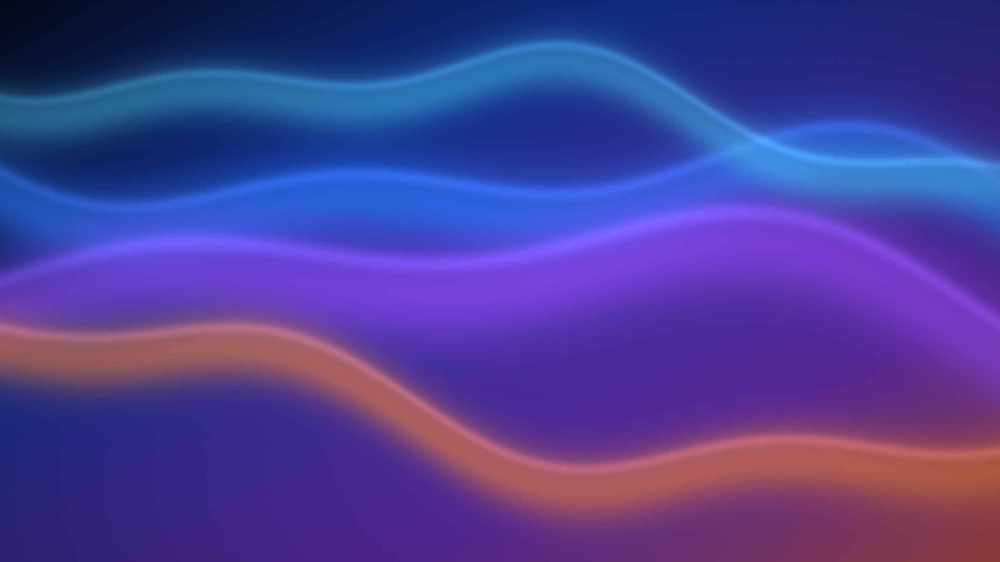

# Omarchy Liquid Glass

A macOS Tahoe-style "Liquid Glass" theme for [Omarchy](https://omarchy.org): translucent blurred bar and panels, WhiteSur GTK/icons, macOS cursor, SF Pro / SF Mono fonts, a glass dock, an Apple menu, a macOS-style app menu and a unified control center.



## Requirements

- Omarchy (Arch Linux, Hyprland, omarchy-shell) with `omarchy` on your `PATH`
- `jq`, `7zip`, `cpio`, `curl` (pacman)
- AUR: `whitesur-gtk-theme`, `whitesur-icon-theme`, `apple_cursor` (needs `yay`)

`install.sh` installs the missing ones for you.

## Install

```bash
omarchy theme install https://github.com/danluan/omarchy-liquid-glass-theme.git
~/.config/omarchy/themes/liquid-glass/install.sh
```

Preview first with `install.sh --dry-run`. Other flags: `--yes` (no prompts, applies the theme at the end), `--with-lua` (see Known limitations).

### What install.sh changes

1. Installs missing dependencies (pacman, then AUR via yay).
2. Adds the 4 plugins below to `~/.config/omarchy/plugins/` with `omarchy plugin add` (only if absent; they are added, not enabled).
3. Copies two hooks to `~/.config/omarchy/hooks/theme-set.d/`:
   - `50-liquid-glass-appearance.sh`: while this theme is active, sets GTK theme, icons, cursor and fonts; any other theme restores your previous values. On first activation it downloads SF Pro / SF Mono (see Fonts).
   - `51-liquid-glass-shell.sh`: while this theme is active, swaps the bar layout, the dock and the Apple menu in `~/.config/omarchy/shell.json` using `~/.config/omarchy/shell-profiles/liquid-glass.json`; other themes switch back to your `normal.json` profile (saved automatically from your live config).
4. Copies `extras/shell-profiles/liquid-glass.json` to `~/.config/omarchy/shell-profiles/` only if it does not exist yet (an existing one is left untouched).
5. Optionally runs `omarchy theme set "Liquid Glass"`.

Nothing else on your system is modified.

## Uninstall

```bash
~/.config/omarchy/themes/liquid-glass/uninstall.sh          # switches theme, removes hooks + profile
~/.config/omarchy/themes/liquid-glass/uninstall.sh --purge  # also removes the 4 plugins
omarchy theme remove "Liquid Glass"                         # finally, delete the theme itself
```

AUR packages are never removed automatically.

## Plugins

| Plugin | Repo | Role |
| --- | --- | --- |
| `danluan.dock` | [liquid-dock-plugin](https://github.com/danluan/liquid-dock-plugin) | Glass dock with magnification and intellihide |
| `danluan.apple-menu` | [apple-menu-plugin](https://github.com/danluan/apple-menu-plugin) | Apple logo menu button |
| `danluan.app-menu` | [app-menu-plugin](https://github.com/danluan/app-menu-plugin) | Bold focused-app name in the bar |
| `danluan.control-center` | [control-center-plugin](https://github.com/danluan/control-center-plugin) | Unified control center pill and panel |

Plugins run unsandboxed inside omarchy-shell. Review their code if you care.

## Fonts

SF Pro and SF Mono are **not** included in this repo. On first activation, `install-apple-fonts.sh` downloads them from Apple's developer CDN into `~/.local/share/fonts/apple`. They remain under Apple's license; by running the script you accept it. Until they are installed, the system fallback fonts are used.

## Known limitations

- Omarchy ignores `hyprland.lua`, `neovim.lua` and `vscode.json` for themes installed from git (they run code). Without them you lose blur rules, animations and macOS title bars. Review those files, then run `install.sh --with-lua` to remove the theme's `.git` so Omarchy applies them (`omarchy theme update` stops working afterwards; reinstall to update).
- The control center embeds panels from other plugins (Galaxy Buds, Midea, DoHome strip, NetExtender). Those are not part of this package, so their cards stay empty unless you have them.
- Wallpapers (`backgrounds/`) and fonts may carry their own terms; check before redistributing. The MIT license covers the code only.
- Tested only on the author's setup; the bar layout is a generic template, adjust `shell-profiles/liquid-glass.json` to taste.

## Feedback

Please open an issue: <https://github.com/danluan/omarchy-liquid-glass-theme/issues>

## Português

Tema Liquid Glass (estilo macOS Tahoe) para o Omarchy, com dock, menu Apple, menu do app e central de controle. Instalação:

```bash
omarchy theme install https://github.com/danluan/omarchy-liquid-glass-theme.git
~/.config/omarchy/themes/liquid-glass/install.sh
```

Use `--dry-run` para simular. As fontes SF Pro/SF Mono são baixadas da Apple na primeira ativação (licença da Apple; não são redistribuídas). Para desinstalar: `uninstall.sh` (e `--purge` para remover os plugins). Envie feedback pelas issues do GitHub.
